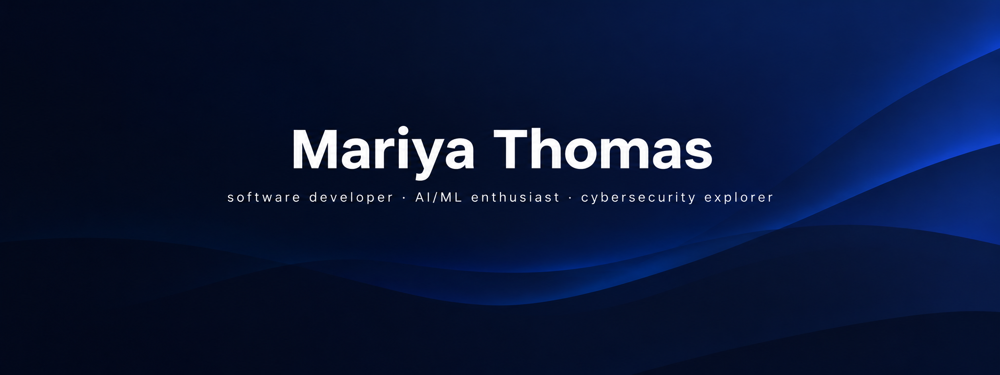

  

  
  
  
  
  

## Hey, I'm Mariya Thomas

I'm Mariya Thomas, a **BCA Honours 5th Semester student at Rajagiri College of Management & Applied Sciences, Kochi**, interested in software development, artificial intelligence, and cybersecurity.

I enjoy building practical applications, experimenting with new technologies, and understanding how different areas of computer science connect.

My journey began with programming and web development and has gradually expanded into **AI/ML, data science, cloud technologies, and cybersecurity**.

I'm continuously learning, building projects, and gaining practical experience through technology communities, volunteering, and hands-on work.

## Areas of Interest

**Artificial Intelligence & Machine Learning** · **Cybersecurity**

## Technology Stack

### Languages

  

### Web Development

  

### Databases

  

### Tools & Platforms

  

## Cybersecurity Journey

Cybersecurity is one of the areas I'm actively exploring.

My interest in the field has grown through learning, certifications, community participation, and volunteering at cybersecurity events.

  
  
  

I'm particularly interested in **ethical hacking, web security, cybercrime investigation, security awareness, and the intersection of AI and cybersecurity**.

## Community & Volunteering

  
  
  
  

I've had the opportunity to volunteer, collaborate, and learn through cybersecurity, cloud, and developer communities. These experiences have helped me develop both **technical and teamwork skills** beyond the classroom.

## What I'm Building

Most of my GitHub reflects my learning journey **academic projects, experiments, web applications, and projects exploring new technologies**.

I'm particularly interested in projects that combine:

**Software Development + AI + Data + Security**

## Currently Learning

**Artificial Intelligence & Machine Learning**  
**Cybersecurity Fundamentals**  
**Full-Stack Development**

## Beyond Code

I believe technology is best learned by **building, experimenting, collaborating, and staying curious**.

Outside academics, I enjoy participating in technology communities, volunteering at conferences, attending meetups, working with teams, and learning from people with different technical backgrounds.

## Connect

  

### Learning · Building · Exploring
